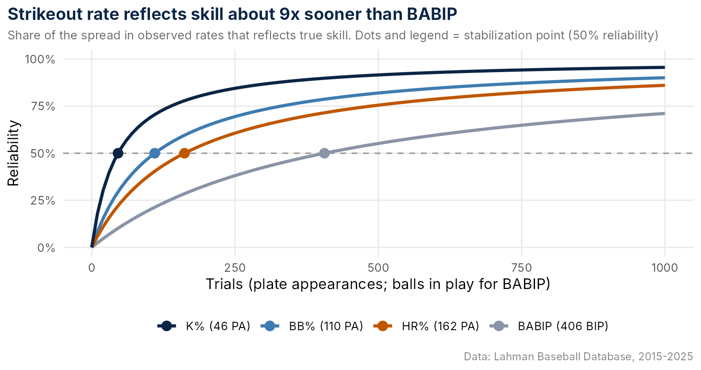
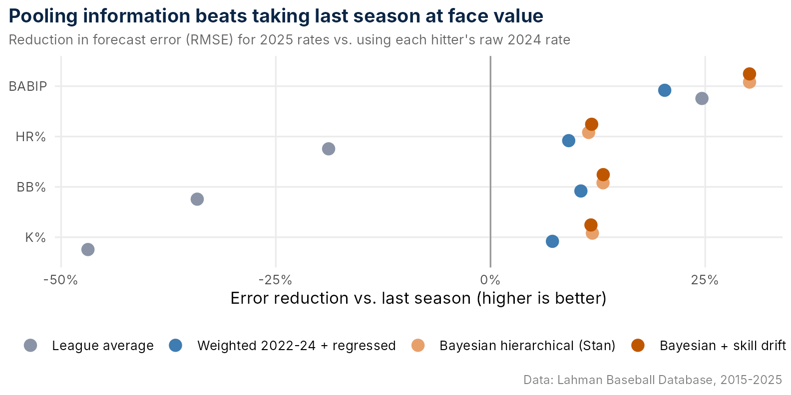
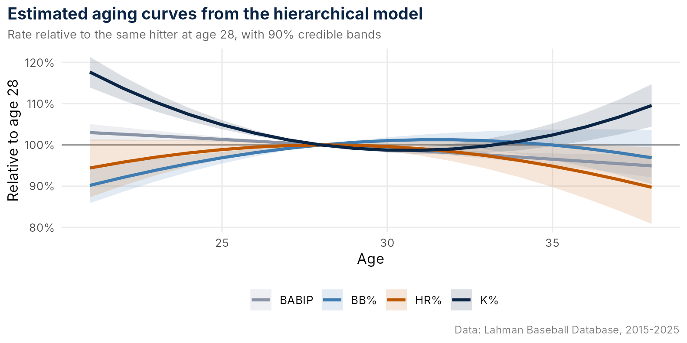
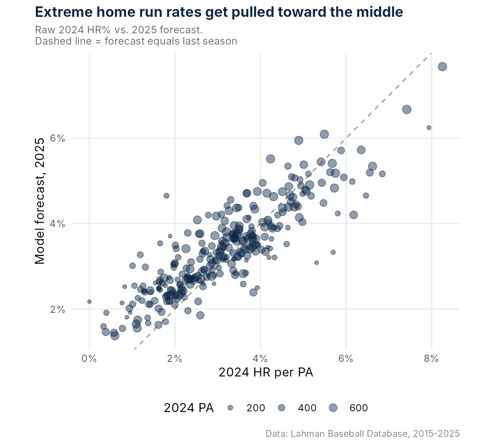

# Separating Skill From Luck in MLB Hitting

**How many plate appearances does it take before a hitter's stats reflect real skill, and can a Bayesian model forecast hitters better than taking last season at face value?**

**[Read the 2-page summary report (PDF)](report.pdf)**

This project answers both questions with 2015–2025 MLB data. It estimates how quickly four hitting rates become reliable, then builds Bayesian hierarchical models in Stan that forecast each hitter's 2025 rates using only data through 2024, and scores those forecasts against what actually happened.

## Key findings

- **Strikeout rate reflects skill about 9x sooner than BABIP.** Half the spread in strikeout rates reflects true skill after about 46 plate appearances. Walk rate takes about 110, home run rate about 160, and batting average on balls in play (BABIP) about 400 balls in play, which is close to a full season.
- **The Stan model beat every simpler forecast on all four stats.** Compared with using a hitter's raw 2024 rate, it cut 2025 forecast error by 12% for K%, 13% for BB%, 11–12% for HR%, and 30% for BABIP. It also beat a Marcel-style weighted-and-regressed forecast on every stat.
- **For BABIP, last season is worse than knowing nothing.** Giving every hitter the league average beat using his own 2024 BABIP, because one season of BABIP is mostly noise. The model does better than both by combining a hitter's history with the league average in proportion to how much his data can be trusted.
- **The model's uncertainty is too narrow for strikeouts and walks.** Its 80% forecast intervals caught 82% of 2025 BABIP results and 78% of HR% results, but only 73% for BB% and 67% for K%. Adding a term for year-to-year skill changes helped only slightly (K%: 63% to 67%). The misses were split evenly above and below the forecasts and across age groups, so the next step is a likelihood that allows extra variation within a season (see [Limitations](#limitations)).

## Methods

### Data

Season totals from the [Lahman Baseball Database](https://sabr.org/lahman-database/) (R package `Lahman`), 2015–2025. Stints for traded players are combined, pitchers batting are removed, and age is measured on July 1 of each season.

| Stat | Successes | Trials |
|---|---|---|
| K% | Strikeouts | Plate appearances |
| BB% | Walks | Plate appearances |
| HR% | Home runs | Plate appearances |
| BABIP | Hits on balls in play | Balls in play (AB − SO − HR + SF) |

### 1. Stabilization points (`R/01_stabilization.R`)

Each hitter's true rate is modeled as a draw from a league-wide beta distribution, and his observed count as binomial given that rate. Fitting this beta-binomial model by maximum likelihood gives the **stabilization point** M: after M trials, half of the variance in observed rates reflects true skill differences (reliability = n / (n + M)). Each season is fit separately, so league-wide shifts don't inflate the spread, and the median across seasons is reported (the 60-game 2020 season is excluded).

| Stat | Stabilization point | Range across seasons |
|---|---|---|
| K% | 46 PA | 43–49 |
| BB% | 110 PA | 96–132 |
| HR% | 162 PA | 136–209 |
| BABIP | 406 balls in play | 356–587 |



### 2. Forecasting 2025 (`R/02_forecast_models.R`)

Every model uses only data through 2024 and is scored on the **302 hitters** with at least 200 PA in 2025 and 100 PA in 2024.

| Forecast | How it works |
|---|---|
| League average | Every hitter gets the 2024 league rate |
| Last season | The hitter's raw 2024 rate |
| Weighted + regressed | 2022–24 counts weighted 5/4/3 (like Marcel), then regressed toward the league rate by the stabilization point from step 1 |
| Bayesian hierarchical (Stan) | Binomial model with a quadratic age curve, season effects, and a partially pooled player effect. Recent seasons are weighted more (0.75 per year back) |
| Bayesian + skill drift (Stan) | The same model plus a player-season effect, so a hitter's skill can change from year to year |

The Stan models are fit with `brms` on about 4,400 player-seasons from 1,292 hitters (2018–2024): 2 chains × 1,500 iterations, with weakly informative priors. There were no divergent transitions, and every R-hat is 1.02 or below. The usual target is 1.01, so longer chains would make the estimates more precise.

**Results: forecast error (RMSE) for 2025 rates**

| Stat | League avg | Last season | Weighted + regressed | Bayesian | Bayesian + drift | Noise floor |
|---|---|---|---|---|---|---|
| K% | 0.059 | 0.040 | 0.037 | **0.035** | **0.035** | 0.019 |
| BB% | 0.031 | 0.023 | 0.020 | **0.020** | **0.020** | 0.013 |
| HR% | 0.016 | 0.013 | 0.012 | **0.012** | **0.012** | 0.008 |
| BABIP | 0.032 | 0.042 | 0.033 | **0.029** | **0.029** | 0.026 |

The **noise floor** is the error a forecast would still have if it knew every hitter's true skill exactly, because 2025 results include binomial luck. BABIP forecasts are already close to that floor. For K%, there is more room to improve.



**Calibration: share of 2025 results inside the 80% forecast interval**

| Stat | Bayesian | Bayesian + drift |
|---|---|---|
| K% | 63% | 67% |
| BB% | 74% | 73% |
| HR% | 77% | 78% |
| BABIP | 81% | 82% |

### 3. Aging curves

The hierarchical model also estimates how each rate changes with age. Strikeout rate falls through the early 20s, bottoms out around 30, and rises after. Walk rate climbs into the early 30s. Home run rate peaks in the late 20s and drops about 10% by age 38.



### 4. Changes that luck doesn't explain

Hitters whose 2025 rate landed outside the drift model's 80% interval, ranked by how far outside, are the changes most likely to be real (a new approach, an injury, or a development leap). These are the cases worth a closer look from scouts and coaches. Full list: `output/2025_changes_beyond_noise.csv`.

| Stat | Hitter | Age | 2025 PA | Forecast | Actual |
|---|---|---|---|---|---|
| HR% | Junior Caminero | 21 | 653 | 3.2% | 6.9% |
| HR% | Cal Raleigh | 28 | 705 | 5.4% | 8.5% |
| K% | Jackson Holliday | 21 | 649 | 30.8% | 21.6% |
| K% | Jacob Wilson | 23 | 523 | 15.1% | 7.5% |



## Limitations

- **Intervals are too narrow for K% and BB%.** The binomial likelihood assumes every plate appearance in a season is independent with the same probability. Real seasons include injuries, role changes and in-season adjustments that add variance. A beta-binomial likelihood is the next thing to test.
- **Season totals only.** Lahman has no pitch-level or batted-ball data. With Statcast data (exit velocity, launch angle, swing decisions), skill could be estimated from underlying inputs, which stabilize faster than outcomes.
- **One backtest season.** Results are scored on 2025 only. Rolling backtests across several seasons would give more reliable comparisons between models.
- **A simple age curve.** The quadratic age term is the same for every hitter. Player-specific development curves could help with young hitters like Holliday and Caminero.
- **Some players are excluded.** Hitters without 100 PA in 2024 aren't in the test set, which leaves out rookies, where forecasting is hardest.

## Run it yourself

Requires R with `Lahman`, `dplyr`, `tidyr`, `purrr`, `ggplot2`, `scales`, and `brms` (which installs Stan through `rstan`). The first run fits eight Stan models, which takes about 40 minutes; fitted models are cached in `output/models/`, so later runs take a few minutes.

```r
install.packages(c("Lahman", "dplyr", "tidyr", "purrr", "ggplot2", "scales", "brms"))
```

```bash
Rscript run_all.R
```

## Repository layout

```
R/00_setup.R               packages, settings, player-season table
R/01_stabilization.R       beta-binomial stabilization points
R/02_forecast_models.R     benchmark forecasts, Stan models, 2025 backtest
R/03_figures.R             charts
run_all.R                  runs everything, writes CSVs and charts to output/
output/                    results (CSV) and figures (PNG)
report.pdf                 2-page summary of methods and findings
```

## Author

**Ashwin Subramaniam**, Statistics & Data Science, UT Austin ([GitHub](https://github.com/ashwinsubramaniam30))
